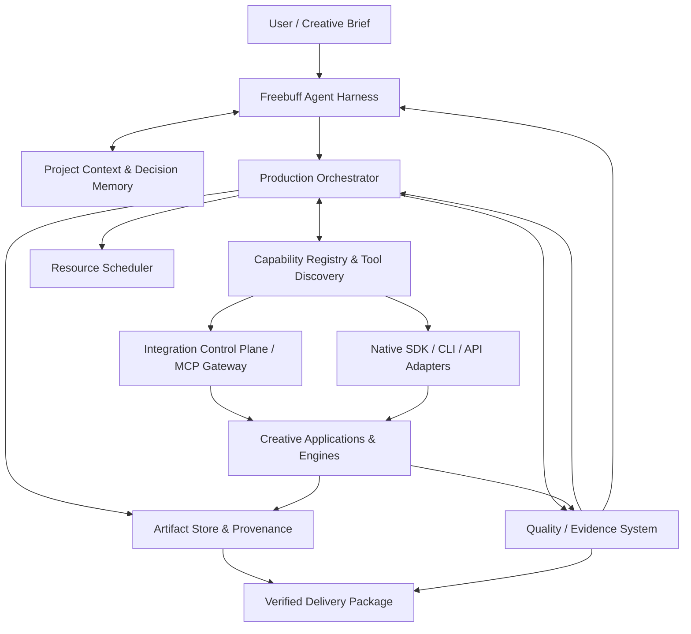

# Reference Architecture

## Architectural intent

The architecture should provide one coherent user experience and project brain while delegating specialized work to proven applications and components. Keep the agent, workflows, tool protocol, application adapters, artifacts, and quality system distinct. The system is provider-neutral and modular; it does not require every part to be custom built.

## Context diagram

## Logical layers

### 1. User and project experience

Project dashboard, brief editor, references, art bible, task progress, generated outputs, side-by-side review, approval actions, issue tracking, evidence browser, and delivery package. This may be integrated with Freebuff's interface rather than created as a separate UI from day one.

### 2. Agent harness (Freebuff-facing)

Intent analysis, context selection, planning, model/provider routing, specialist roles/skills, tool selection, reflection, critique, repair decisions, and reporting. Keep this layer decoupled from concrete DCC and engine implementations.

### 3. Production orchestration

Task graph, dependencies, checkpoints, durable job state, retries, cancellation, approval gates, idempotency, resource reservations, concurrency control, and project-level locking. Evaluate existing workflow engines before building an orchestration runtime.

### 4. Capability and integration control plane

Capability discovery, schema inspection, tool invocation, health checks, application session routing, skill loading, telemetry, and adapter version reporting. DCC-MCP Core is a priority candidate; native adapters may coexist. MCP is one protocol, not a substitute for authorization, validation, or workflow durability.

### 5. Application adapters

Thin, domain-aware bridges for Blender, ComfyUI, Unreal, Unity, Godot, CAD, audio, video, 2D design, and other apps. Use native APIs whenever the operation is best handled inside the application. An adapter provides typed operations, validation, permission scoping, postconditions, diagnostics, and evidence capture.

### 6. Production pipeline recipes

Versioned domain workflows that transform inputs into outputs: concept-to-character, environment, prop, UI, material, VFX, audio, video, app, game vertical slice, release, and other production tasks. Each recipe is a DAG/graph with artifact contracts, resource needs, checkpoints, and acceptance tests.

### 7. Artifact and provenance layer

Content-addressed artifacts, source/project files, exports, generated outputs, manifests, version links, lineage, checksums, metadata, and retention policy. Keep large files outside normal Git where appropriate.

### 8. Quality and evidence layer

Requirement traceability, technical validators, native app tests, runtime tests, visual/audio evaluation, performance benchmarks, compliance, evidence packaging, and release decisions.

### 9. Operations/security/resource layer

Process supervision, secrets, workspace policy, sandboxing, network allowlists, resource telemetry, scheduling, audit logs, upgrade management, and recovery.

## Architecture invariants

- No universal global mutable state.
- Clear data ownership, typed contracts, and explicit lifecycle boundaries.
- Tool adapters cannot redefine user intent or bypass acceptance gates.
- No arbitrary remote shell or plugin code execution without a permission and isolation policy.
- All irreversible actions require explicit approval or narrowly scoped pre-authorization.
- Every job has a unique ID, project ID, idempotency key where applicable, state, timestamps, cancellation semantics, and evidence location.
- Every artifact has a stable ID, type, version/hash, lineage, license/provenance state, and validation state.
- Every capability declares supported versions and maturity.
- Project writes are isolated, atomic where possible, and recoverable.
- Cross-application changes use interchange contracts and round-trip checks.
- The LLM is not a source of truth for app state; inspect the application.

## Preferred adoption boundary

Adopt DCC-MCP Core if it passes compatibility/security/quality tests as a gateway and capability registry. Keep Freebuff as primary intent and agent layer. Use LangGraph or another harness/workflow framework only where a proven fit exists. Use Temporal or another durable workflow engine only if required by long-running job recovery. Keep native APIs available for deeper operations. This is a target hypothesis subject to ADR, not a final stack lock.

## Deployment shape

Initial deployment should be a local single-user studio on Windows. Prefer local process communication and loopback-bound services. Separate processes for applications/model servers when isolation and fault recovery justify them. Add multi-machine or remote execution only with authenticated transport, explicit trust boundaries, and reproducible environment images.
